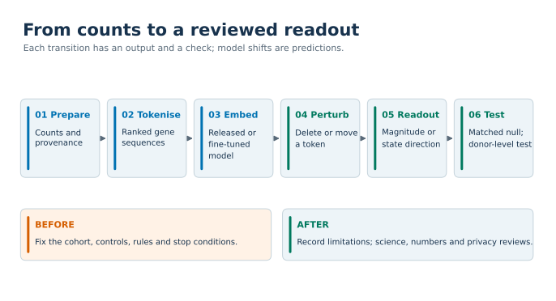

# Geneformer research methods

*Artwork reused from [Kaisar's research website](https://kays3.github.io/). AI-generated illustration, not a scientific result.*

Working criteria, a pipeline, known failure modes and reusable patterns for research that fine-tunes Geneformer and runs in silico perturbation (ISP: editing a cell's token sequence and reading how its embedding moves).

This repository records what one research group learned over about five months of Geneformer work on single-cell and single-nucleus data. It is a methods record. It is not a software package and it holds no trained model.

## Who it is for

- People who plan a Geneformer fine-tune or an ISP screen and want a checklist of what to fix before spending GPU time.
- Reviewers who need to judge whether an ISP result can be trusted.
- People who hit a strange result (all-zero shifts, a classifier that predicts one class, two runs that disagree) and want to know the likely causes.

It assumes you already know the Geneformer library and its published protocol (*Nature Protocols*, 2026, doi:10.1038/s41596-026-01364-8). Nothing here replaces that protocol. Where our criteria differ from it, `docs/CRITERIA.md` places the two side by side.

## What is in it

| File | Content |
|---|---|
| [`docs/CRITERIA.md`](docs/CRITERIA.md) | What a study must fix before it runs and what a report must state, including the five items every deliverable carries |
| [`docs/PIPELINE.md`](docs/PIPELINE.md) | The stages from raw counts to a gated result, each with inputs, outputs and checks |
| [`docs/ISSUES.md`](docs/ISSUES.md) | Failure modes: symptom, root cause, how to detect it, fix |
| [`docs/APPROACHES.md`](docs/APPROACHES.md) | What worked, what did not, and when to use which design |
| [`docs/STATISTICS.md`](docs/STATISTICS.md) | Units, nulls, attainable p values, families, stability, wording of outcomes |
| [`docs/DATASETS.md`](docs/DATASETS.md) | The public datasets behind every number quoted here, with accessions and models |
| [`templates/`](templates) | A pre-registration and amendment template, a methods record, a gate checklist |
| [`patterns/`](patterns) | Small generic code examples written for this repository |

## Evidence and its limits

Each statement here rests on one of two kinds of evidence, and the text says which.

- **Public data.** Numbers come only from analyses of public datasets. Each number is given with the dataset accession and the model. The analysis code for these studies is not public, so the numbers are reported results, not reproducible artifacts. None of these analyses is peer reviewed.
- **Internal record.** Some lessons come from studies of unpublished data. For these we state what happened in words (for example, "a fine-tune collapsed to a constant predictor and the run still exited 0") and give no result number, gene, figure or cell count.

Other limits a reader should keep in mind:

- The work used Geneformer V2 checkpoints (104M and 316M) and one pinned library commit. Library behaviour described here was read at that commit and may change.
- Most lessons come from T cells in tumour atlases, one heart atlas and one single-nucleus study. They are not a survey of tissues.
- Several criteria (a 20-control rule, a 50-cell floor, a 0.60 gate) are conventions we fixed in advance. We claim they were useful, not that they are optimal.
- An embedding shift is a statement about the model's representation of a cell. It is not a measured knockout, and none of this replaces an experiment.

## Illustrated guide

[Browse all figures, their sources and regeneration command](figures/README.md).

## Licence

Code under `patterns/` is released under the MIT licence (`LICENSE`). Text and templates are released under CC BY 4.0 (`LICENSE-DOCS.md`).
