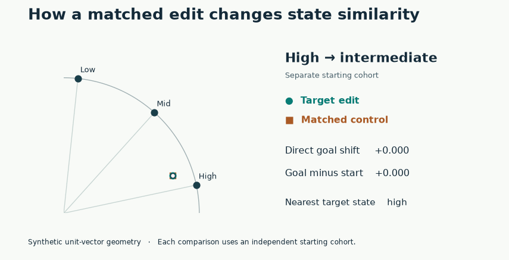
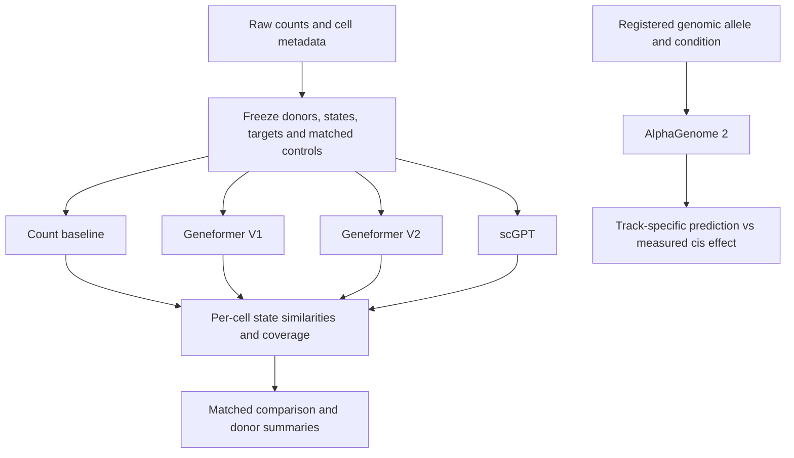
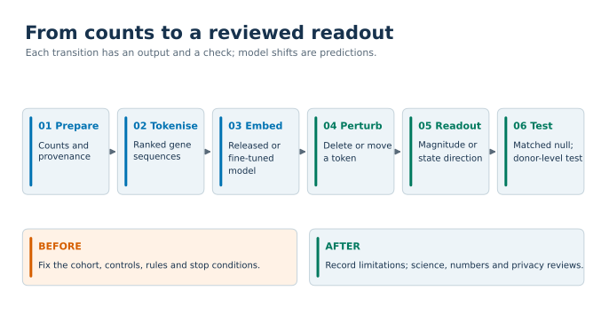

# Open-source single-cell ISP pipeline

Run matched in silico perturbation (ISP) benchmarks for single-cell and single-nucleus RNA sequencing. Use a count baseline, Geneformer V1, Geneformer V2 or scGPT to measure how gene deletions change the similarity of a cell to predefined states. AlphaGenome 2 supplies a separate sequence-based comparison for a registered allele and molecular track.

## Run the first benchmark

From a checkout with Python 3.9 or later:

```sh
python -m pip install .
scrna-isp demo results/demo
```

The offline demo uses synthetic counts, two reference donors and two independent evaluation donors. Open `coverage.tsv` for state assignments and eligibility, `shifts.tsv` for target and matched-control effects, `donor_summary.tsv` for per-donor estimates and `receipt.json` for hashes and per-state recall. The demo runs the count baseline. The model workflows use your checkpoint-compatible environment and weights.

[Run with your data](docs/RUNNING.md) · [Benchmark criteria](docs/ORDERED-STATES.md) · [Registration, locking and scoring](standards/single-cell-isp/README.md)

## How the comparison works



The first example favors the intermediate state while the edited point remains closest to high. The second starts with a different point and crosses the nearest-state boundary. The circle represents unit-vector cosine geometry. [Static alternative](figures/08-state-shifts.png) · [Formulas and interpretation](docs/ORDERED-STATES.md)



## Methods record

The original field guide documents fine-tuning and perturbation experiments, failed checks and study-specific conventions. The executable pipeline extends that guide with matched-input workflows and a reproducible synthetic benchmark.

## What is in it

| File | Content |
|---|---|
| [`docs/CRITERIA.md`](docs/CRITERIA.md) | What a study must fix before it runs and what a report must state, including the five items every deliverable carries |
| [`docs/PIPELINE.md`](docs/PIPELINE.md) | The stages from raw counts to a gated result, each with inputs, outputs and checks |
| [`docs/ISSUES.md`](docs/ISSUES.md) | Failure modes: symptom, root cause, how to detect it, fix |
| [`docs/APPROACHES.md`](docs/APPROACHES.md) | What worked, what did not, and when to use which design |
| [`docs/STATISTICS.md`](docs/STATISTICS.md) | Units, nulls, attainable p values, families, stability, wording of outcomes |
| [`docs/DATASETS.md`](docs/DATASETS.md) | The public datasets behind every number quoted here, with accessions and models |
| [`templates/`](templates) | A pre-registration and amendment template, a methods record, a gate checklist |
| [`patterns/`](patterns) | Small generic code examples written for this repository |

## Evidence and its limits

Each statement here rests on one of two kinds of evidence, and the text says which.

- **Public data.** Numbers come only from analyses of public datasets. Each number is given with the dataset accession and the model. The analysis code for these studies is not public, so the numbers are reported results, not reproducible artifacts. None of these analyses is peer reviewed.
- **Internal record.** Some lessons come from studies of unpublished data. For these we state what happened in words (for example, "a fine-tune collapsed to a constant predictor and the run still exited 0") and give no result number, gene, figure or cell count.

Other limits a reader should keep in mind:

- The original field guide used Geneformer V2 checkpoints (104M and 316M) and one pinned library commit. Library behaviour described here was read at that commit and may change.
- Most lessons come from T cells in tumour atlases, one heart atlas and one single-nucleus study. They are not a survey of tissues.
- Several criteria (a 20-control rule, a 50-cell floor, a 0.60 gate) are conventions we fixed in advance. We claim they were useful, not that they are optimal.
- An embedding shift is a statement about the model's representation of a cell. It is not a measured knockout, and none of this replaces an experiment.

## Standard for new single-cell datasets

[Start a private ISP study](standards/single-cell-isp/README.md) with a donor-held-out design for Geneformer V1, V2 and scGPT, or a registered allele-expression comparison for AlphaGenome 2. Both workflows include a study initializer, a hash lock, a score command and synthetic inputs.

## Cross-model perturbation benchmark

[Run the cardiac ISP benchmark](benchmarks/cardiac-isp/README.md) for Geneformer V1, V2, scGPT and AlphaGenome 2. It provides a published numerical anchor, model-specific checks and a local scorer with synthetic inputs.

## Illustrated guide



[Browse all figures, their sources and regeneration command](figures/README.md).

## Licence

Pipeline and example code are released under the MIT licence (`LICENSE`). Text and templates are released under CC BY 4.0 (`LICENSE-DOCS.md`).

## Research website

[Explore the current computational research](https://kays3.github.io/research/#digital-pathology) and [the broader research portfolio](https://kays3.github.io/). This repository is a methods record: it does not by itself establish biological mechanisms or report the outcome of a particular perturbation experiment.
