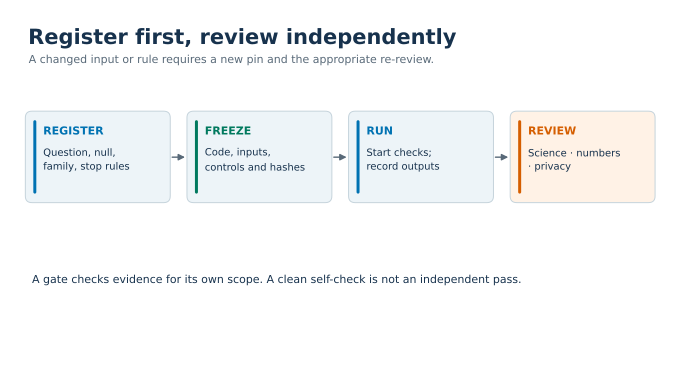

# Criteria for implementation and reporting

[Figure sources and regeneration](../figures/README.md).

These are the rules we fix before a Geneformer study runs and the items a report must state. Each rule exists because its absence cost us a result, GPU time or a retraction; `docs/ISSUES.md` gives the cases.

Tags: `[D1]` to `[D4]` point to a public dataset in `docs/DATASETS.md`. "Internal record" marks a lesson from unpublished data, given without numbers.

## 1. The five items every deliverable states

A report, slide deck or pull request that presents a Geneformer result states all five. A reviewer fails it if one is missing.

1. **Code.** The path of the code that ran and its commit.
2. **Split.** How cells were assigned to train, evaluation and test, by what unit (donor), and the hash of the split table. A zero-shot run has no training split, and the text says exactly that. Cross-fitted folds used only to build readout axes are a split of cells for axes, not a training split.
3. **ISP states.** The start state and the goal state of every perturbation, and how the goal is represented (a centroid, or a direction between two centroids).
4. **Model.** The model, the checkpoint, the sha256 of the weights file, the numerical precision, and the library commit.
5. **Fine-tuned against out-of-the-box.** Plots of the fine-tuned model beside the released model on the same readouts. If no fine-tuned run exists, the report says so and names that as a limit.

## 2. Before any output exists

**Register the design.** One committed file, written before the first model call, fixes:

- the question and the population (cells, donors, tissue, start and goal states);
- the primary statistic, its sidedness and the predicted direction as its own clause;
- the null (matched control genes, matched sets or random genes) and how it is drawn, with the seed;
- the multiple-testing family and its size;
- alpha, and the smallest p the design can reach at the planned n (see `docs/STATISTICS.md`, section 3);
- eligibility rules (minimum token-positive cells, minimum donors);
- the stability gate;
- the fixed vocabulary of outcomes (section 5 below);
- stop rules and the GPU-hour cap;
- what the study cannot show.

**Identify genes by Ensembl ID**, never by symbol. Two similar symbols were once confused (internal record).

**Amend, never rewrite.** A change after registration is a dated, numbered amendment appended to the file. Before the push, check two things: the diff shows zero deleted lines, and the first N bytes of the new file hash to the whole old file. An amendment says what data existed when it was written. If the amendment depended on something a screen had already shown, a dependency note says so. An erratum (a wrong timestamp, a wrong "nothing existed yet" claim) is also appended, never edited in.

**Re-run feasibility after an amendment.** If an amendment changes the inputs or the statistics basis, every feasibility check that used the old basis runs again. Control strata built on pooled statistics became unmatchable after a design switched to one subgroup (internal record).

**Get an independent sign-off before GPU time.** A second reader passes the registration and the run package. The sign-off names file hashes; a change to a named hash voids it.

**Select the dataset by structure only.** The selection rule is registered before any candidate is screened. The screen may read donor tables, per-donor cell counts, labels and file sizes. It may not read expression values, published results on those donors, or classifier accuracy. Our rule required:

- a floor on qualifying donors per group (we used 12, with 16 preferred);
- a minimum of cells per donor (100) and an equal fixed-seed draw per donor, so each donor weighs the same;
- one sample site per group (primary tumour only; no effusions, blood or nodes mixed in);
- no study-by-group confounding: each contributing study supplies both groups, or the groups are paired within donor;
- one assay family, raw integer counts, open access.

Thresholds are not relaxed to rescue a candidate. Every screened candidate is recorded with the first criterion it failed.

## 3. Before the GPU starts

The driver refuses to start unless all of these hold:

- the code manifest matches (sha256 of every script);
- every input table matches its pinned hash, including the split table and the null draw;
- the weights file matches its pinned sha256, and the library is at the pinned commit;
- the GPU is idle and host memory is above a floor;
- the time window has not passed;
- no other run holds the output folder (a claim lock).

Then, in order:

1. **Memory test** at the real maximum sequence length, in the mode that will run (training or inference). A failed memory test is not retried by a restart.
2. **No-op gate.** A perturbation with an empty edit must give a shift of exactly zero. Use two independent forward passes on the same input; a reused tensor gives zero by algebra and proves nothing.
3. **Resolvability gate.** On a small sample: the share of nonzero shifts, a floor on the median absolute shift, a minimum relative difference between the state embeddings, and enough donors. A run that fails is "unresolved" and gets no reading. The no-op gate cannot detect shifts that are all zero; this gate can.
4. **Classifier gate** (fine-tuned designs). Ours: pooled held-out balanced accuracy of at least 0.60 and an exact two-sided sign test over donors with p at or below 0.05. A failure stops ISP and is reported as a finding, with all gate numbers and its bound (this model, cohort and recipe).
5. **Cost projection** from rates measured on the target cells, set against the cap.

A machine-readable file lists every gate with the registration line that requires it. The analysis launcher refuses to start unless each gate's result file exists and shows the required value.

## 4. During and after the run

- **Hard cap and time stop.** The driver checks charged GPU seconds between chunks and between epochs. Each kind of stop has its own exit code. A reserve is held back for readout steps so training cannot spend the whole cap.
- **Nothing is dropped to fit a budget.** Controls, the overexpression arm and the donor floor are never cut. On a projected overrun the run stops and reports.
- **A stop rule that fires ends the arm.** No further attempt and no hyperparameter change without a new decision.
- **No statistic is read before the run ends.** The driver writes the readout. Raw output stays unread until the gates pass.
- **Spot-check early output** for exact zeros, NaN and the median absolute shift, per operation.
- **Outputs are never overwritten.** A re-run gets a new folder. A failed run's outputs are kept and reported in full beside the working run, and a re-run changes one thing only, so the cause is tested.
- **After the run:** inputs are re-hashed and unchanged, every completion marker is present, no stop file exists.
- **The run record** lists every change made to code or text after the run, with the reason, and states whether any script that ran or any result changed.

## 5. Reporting

**Every gene keeps a row.** Each registered gene is reported with one status from a fixed vocabulary. We used: `positive`, `negative`, `opposite_direction`, `not_estimable` (with the reason), `control_draw_sensitive_open`, `no_op_failed`, `not_run_by_design`, `stopped_not_analysed`, `unresolved`. "No effect" is never written.

**Evidence levels.** A gene that only passed a screen is at screen level. It is called supported only after the donor-level, control-adjusted, two-operation test. In one study a gene set reached a set-level label while 0 of 7 of its genes reached the supported level `[D4]`; the report said both.

**Claims match the test.** "Beats its own matched controls" is what a matched-control test shows. "This class of genes has larger effects" is a different claim.

**Limits are registered with the claims.** Examples we registered: within-donor pairing does not remove between-tissue ambient RNA; an ambient flag means "resembles known contaminants on a detection axis", not "is contamination"; the unit of inference with one animal and one library is the cell within that sample.

**No number without its source.** Each number names its file, commit and quantity. Numbers in a report are generated from result files, not typed by hand.

**Post hoc is labelled.** An analysis designed after a result was read says so, with the time it was written. Descriptive rows get no p value and are not added to the family afterwards.

**Sensitivity lines never change a status.** Each open analysis rule has a registered alternative. After unblinding, the report states whether any status would change under the alternative, and calls such a status fragile in the same sentence.

## 6. How these differ from the published protocol

We compared the protocol's criteria with ours on the protocol's own example atlas `[D4]` and on two tumour atlases `[D2, D3]`. The protocol and our set agree on splitting by patient. The main differences:

| Topic | Published protocol | This repository |
|---|---|---|
| Classifier report | Confusion matrix, accuracy, macro F1 on held-out patients, cells pooled | The same, plus per-donor balanced accuracy, an exact sign test over donors and a run-to-run noise band |
| Gene effect | Cell-pooled shift toward the goal against random genes, Wilcoxon, BH | Per-donor value from raw per-cell output, adjusted against matched control genes, exact Wilcoxon over donors, Holm within a registered family |
| Direction | Toward the goal and away from an alternative state | Toward the goal under deletion and the opposite sign under overexpression, read against a random-gene baseline |
| Numerical checks | Quantized against full precision | Cross-host, bf16 and int8 against fp32 per operation, model size |
| Hyperparameters | Tuned on the target data | One fixed recipe across cohorts (we tuned only where we reproduced the protocol) |
| No counterpart in the protocol | | No-op gate, resolvability gate, ambient-RNA rule, random-gene null, fold-heterogeneity downgrade, fixed status vocabulary, pre-registration with hash pins |
| No counterpart in ours | Embedding inspection (UMAP), experimental validation of a top target | Replication in an independent cohort; neither replaces the other |

This comparison did not settle which set is better. Our adoption rule for a merged "balanced" set needed two measurements, and neither was made on its own terms; sensitivity was scored for no criterion because the one validated positive was never scored. The table is a map of differences, not a ranking.
