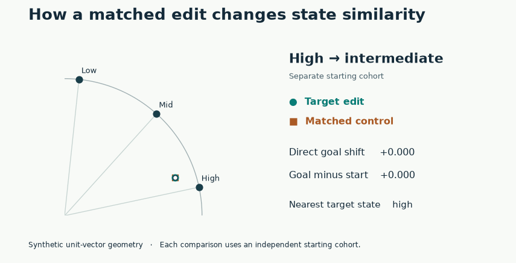

# Benchmark an ordered cell state

Use a separate run for each population, target or predeclared gene set, count layer and registered split. A high, intermediate and low score orders cross-sectional expression states. Establish a healthy or unstimulated reference independently before calling an endpoint normal. To test adjacent steps, edit high-start cells and read the intermediate goal, then edit a separate set of intermediate-start cells and read the low goal. Each step retains the third centroid as an alternate. A trajectory claim additionally needs temporal or lineage evidence.

[Static frame](../figures/08-state-shifts.png) · [Figure source](../figures/src/ordered_states.py)

## Register and fit

1. Fix organism, assay, expression units, raw-count layer, filtering, mapping version, biological unit and intended inference. Separate endogenous genes from transgenes or aliases. Record QC counts, design balance, ambient RNA, doublets and relevant batch variables.
2. Split donors before selecting thresholds, training classifiers or constructing centroids. Fit each state cutoff on reference or training nuclei within the registered population. Export every evaluation nucleus, including absent targets. With one library, retain the pool label, use disjoint nuclei and select descriptive mode.
3. Pin the model and tokenizer together. Save model-native eligible cohorts and the shared cohort. Compare the exact target and control identities on the same nuclei across models. Record expression prevalence, mapped genes, natural token retention, edit cardinality, rank/detection match quality and the final denominator for each target. A pathway name alone cannot identify a joint edit. Save the retained members per nucleus and exclude the target family from the null pool.
4. Freeze matched null draws, control calibration, edit operator, pooling, seed and thresholds. Check independent no-op forwards and replay of saved edits. Compare pretrained and task-tuned checkpoints when the claim concerns fine-tuning. Measure state separability on held-out nuclei, especially intermediate recall, and compare with a simple count baseline.
5. Audit mathematical coupling between the state signature and edited genes. Run an alternative score or a leave-target-family-out label. Include cell-depth and ambient-RNA sensitivities where relevant. Choose a measured perturbation from a comparable assay, cell type and condition before interpreting magnitude.

## Read the output

Let Δ(s) be the change in cosine similarity to state s after the target edit minus the mean change after control edits in the same cell. Each forward uses its model's own normalized state centroids. This implementation averages original reference vectors and unit-normalizes the centroid. Vectors entering each cosine are unit-normalized.

| Report | Interpretation |
|---|---|
| Direct goal shift Δ(goal) | A positive value means the target increased goal similarity more than the controls. Inspect raw goal and control goal separately. |
| Relative shift Δ(goal) − Δ(start) | A positive value favors the goal relative to start. Both similarities can fall. |
| Alternate shift Δ(alternate) | Shows whether an edit also favors the third state. |
| Assignment change | Among original embeddings nearest their expression-defined start, count edits nearest the specified goal. Report target and control counts with the aligned denominator. Ties have their own label. |
| Baseline recall | Include every evaluation nucleus, including edit-ineligible nuclei. Report per-state recall and missing reference or evaluation states. |

Aggregate cells within donor first. Give each biological unit equal weight in a donor comparison. If the estimand weights cell types equally, aggregate within donor and type before applying the registered weights. Report sign agreement, uncertainty, missing donor or type strata, native-coverage sensitivity, model-specific numerical scales and null-calibrated margins. Descriptive sign agreement is insufficient to call a reproducible response. Test both adjacent steps separately, adjust the prespecified family for multiplicity, and report how many donors or studies support both. The toolkit's continuous contrast is distinct from the locked donor pass rule in the study standard.

## AlphaGenome 2 cis benchmark

For a DNA arm, register build, locus, validated REF and ALT, strand, window, target gene, tissue or cell condition, output track, scorer and model fold. Verify the reference sequence. Score focal and matched neighboring alleles, repeat predictions, and check reciprocal direction when the scorer supports it. Keep separate rows for each assay, tissue and observed/imputed track label. Even an observed assay label describes model training support. The allele scores themselves are predictions. Compare them with allele-harmonized expression or accessibility measurements in a comparable cell population. A predicted enhancer effect in human cells cannot validate a downstream pathway-state transition in mouse nuclei. A transcript count matrix alone does not supply a genomic integration allele.

[Geneformer ISP interface](https://geneformer.readthedocs.io/en/latest/geneformer.in_silico_perturber.html) · [scGPT source](https://github.com/bowang-lab/scGPT) · [AlphaGenome scoring](https://www.alphagenomedocs.com/variant_scoring.html) · [Registration and donor-level scoring](../standards/single-cell-isp/README.md)

## Benchmark review matrix

| Question | Evidence to preserve | Decision |
|---|---|---|
| Can the models see the intervention? | Raw detection and shared retained genes per cell, donor and state, plus cardinality of target and control edits | Mark missing strata ineligible; include the denominator in every summary. |
| Does the representation resolve the endpoint? | No-op and edited replay, per-state recall, centroid separations, state-balanced accuracy and a count baseline | Use development data to set the resolvability margin. A poorly resolved intermediate limits crossing claims. |
| Is the endpoint independent of the edit? | Gene overlap including actual deleted tokens, reconstructed endpoint and a leave-overlapping-components-out analysis | Report remaining component identities and counts. A surviving single component changes the biological question. Depth residualization alone leaves gene overlap intact. |
| Is the shift stable? | Direct, relative and alternate shifts on common biological support; alternate state definitions, model versions, seeds, matched-null draws and leave-one-donor/type-out checks | Keep directions and reversals for both steps. Model × step × definition counts are correlated diagnostics. |
| Is there an observed response? | Target and control crossings conditional on correct baseline assignment; independent perturbation, genotype or protein measurements where available | Separate geometry, classification, independent replication and measured biology in the conclusion. |
| Is a cis effect reproducible? | Locus-matched REF/ALT, condition, individual assay tracks, repeat and reciprocal controls, fold sensitivity and measured comparator | Report sign or fold disagreements. Multiple tracks from one locus do not increase the number of independent loci. |
