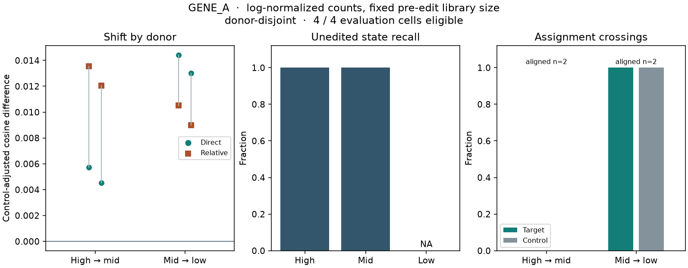

# Run a matched scRNA ISP benchmark

Install the checkout in a clean environment. The core package uses the standard library. Install optional dependencies in the environment that supports each checkpoint, and pin the resolved environment for the study. The project name in pyproject.toml supports local installation.

```sh
python -m pip install .
scrna-isp demo output/example
scrna-isp baseline output/example/counts.tsv output/replay --target GENE_A --control GENE_B
```

The baseline zeroes one gene in a fixed log1p(counts per 10,000) vector. Original library size stays fixed across edits. The count TSV has one row per cell, columns cell, donor, role, state, then unique genes with integer counts. Preselect population and split. Roles are reference/evaluation and state labels are high/mid/low. Pooled material requires a pool identifier and explicit descriptive mode when reference and evaluation pools overlap. Every command expects a new output path.

## Checkpoint inference from AnnData

The model workflow has three independently replayable stages. For each model, first map features and freeze a common manifest. Use unique cell barcodes in obs_names and a raw integer count layer. V1 and V2 use stable Ensembl gene IDs and their own token and median dictionaries. For scGPT use the matching vocabulary's symbols and a separate common-ID column for cross-model matching. Resolve orthologs, duplicate mappings, ambiguous paralogs, endogenous/transgene collisions and multi-library barcodes upstream. The reader currently loads the AnnData object into RAM. Subset the population before running it on a large atlas.

To test real checkpoints without study data, install the h5ad extra, run `scrna-isp-example-h5ad synthetic` and use the generated counts.h5ad and manifest.tsv in the commands below. Expression values and states in this four-gene fixture are synthetic.

The tab-separated manifest adds target_id and control_ids (comma-separated common IDs) to the four metadata fields above. For a multi-gene edit it also accepts target_genes (JSON list of common IDs) and control_sets (JSON list of lists, one per control ID). Supply the exact matched, retained members for each cell. The same manifest goes into every model. Pool separate studies and populations only after donor-level estimates exist.

```sh
python -m pip install '.[h5ad,geneformer]'
scrna-isp-tokenize v1 counts.h5ad manifest.tsv v1/token_dictionary.pkl out/v1-input \
  --layer counts --gene-column ensembl_id --medians v1/gene_medians.pkl
scrna-isp-embed v1 v1/checkpoint out/v1-input/tokens.jsonl out/v1-model --device cuda
scrna-isp benchmark out/v1-model/embeddings.jsonl out/v1-benchmark --model v1-pinned

scrna-isp-tokenize v2 counts.h5ad manifest.tsv v2/token_dictionary.pkl out/v2-input \
  --layer counts --gene-column ensembl_id --medians v2/gene_medians.pkl
scrna-isp-embed v2 v2/checkpoint out/v2-input/tokens.jsonl out/v2-model --device cuda
scrna-isp benchmark out/v2-model/embeddings.jsonl out/v2-benchmark --model v2-pinned
```

Use trusted pickle dictionaries from the checkpoint release. Both Geneformer tokenizers rank mapped expressed genes by count divided by the matched gene median. The common library-size factor cancels in ranking. Ties retain input feature order. V1 admits up to 2,048 genes. V2 reserves CLS and EOS within 4,096 tokens. The adapters average penultimate-layer gene embeddings. Record validated equivalence to the provider tokenizer for your species, dataset and checkpoint. Fingerprint both tokenizations if tie breaking differs.

```sh
python -m pip install '.[h5ad,scgpt]'
scrna-isp-tokenize scgpt counts.h5ad manifest.tsv scgpt/vocab.json out/sc-input \
  --layer counts --gene-column human_symbol --match-column ensembl_id --context 1200
scrna-isp-embed scgpt scgpt out/sc-input/tokens.jsonl out/sc-model --device cuda
scrna-isp benchmark out/sc-model/embeddings.jsonl out/sc-benchmark --model scgpt-pinned
scrna-isp-compare out/matched.tsv out/v1-benchmark out/v2-benchmark out/sc-benchmark
```

The scGPT whole-human adapter expects args.json, vocab.json and best_model.pt. It selects expressed genes in descending count order, breaking ties by token ID. It bins positive expression against 50 within-cell quantiles before truncation, prepends CLS with value zero, and pools CLS. This fixed-input convention must be justified for the study. Each deletion physically removes the same gene identities while preserving other tokens, order and expression values. The comparison command requires identical cell coverage, reference identities, state labels and per-cell target/control members. If retention differs, register the common eligible cohort first. Report the separate native counts and any evaluation donors lost at intersection.

## Import embeddings from another adapter

Use JSON Lines with one record per cell. Each record provides cell, donor, role, state and original (a numeric vector). An evaluation row also provides target_id. An eligible evaluation row adds target (edited vector), control_ids and controls (one edited vector per control). Group edits additionally include target_genes and control_sets. Keep ineligible rows with only their original vector and target ID. The CLI checks dimensions, finite inputs, donor separation, exact control counts and cell uniqueness. Use `--within-library` for descriptive analyses with shared pools. Missing or zero-length embeddings can make a study ineligible.

The pipeline emits coverage even when no target-control pair survives. Per-cell and donor shift tables are written when eligible pairs exist. Review the denominator and missing donor/state combinations before any benchmark call. To apply calibrated directional margins to a locked donor cohort, use the separate [registered study scorer](../standards/single-cell-isp/README.md).

## Score a DNA allele

Install `.[cis]` and configure the AlphaGenome service credential in the process environment. The following request sends a public human allele and human colon glial condition to the AlphaGenome 2 service. It selects single-cell gene-expression tracks for the registered target gene.

```sh
scrna-isp-cis out/cis --chromosome chr4 --position 89753280 --ref G --alt A \
  --gene ENSG00000145335 --condition UBERON:0001155_CL:0000125
```

Verify the focal REF against GRCh38 first. Keep the assay, strand, training-support label and raw score from tracks.tsv. Set the comparison condition, expected direction, flanking controls and model-fold sensitivity in advance. The local [cis ledger scorer](../standards/single-cell-isp/README.md) compares paired predictions with measured effects and uncertainty. Allele-level results have a different denominator and estimand from RNA state shifts.

## Replay and releases

Each run writes input/output or checkpoint hashes. Save the manifest and pinned environment with the registration. Rerun into a new directory and compare tables. Inspect changes in baseline recall, eligible coverage and numerical residuals before interpreting any update. See [ordered-state criteria](ORDERED-STATES.md), [statistical criteria](STATISTICS.md) and the [gate checklist](../templates/gate-checklist.md).

## Visualize a completed benchmark

```sh
python -m pip install '.[plots]'
scrna-isp-plot output/example output/example.png
```



Each connected marker pair comes from one donor. The crossing denominator includes only cells originally nearest the declared start. The figure reads the completed run and verifies its donor-summary hash.

For a prespecified natural-retention intersection, add `--intersection` to `scrna-isp-compare`. The input runs must still cover the same registered reference and evaluation cells. This mode reports the registered, native-eligible and shared cell counts by start state, then checks exact target and control membership on the shared cells.

The encoder receipt includes replay on up to three unedited inputs and the largest absolute coordinate discrepancy. Set acceptable tolerances from model precision and development runs. Store a full environment lock with the study for release. The example cis locus has published experimental provenance. [Soldner et al.](https://www.nature.com/articles/nature17939)

### Pair cis scoring with both RNA workflows

For a single-gene state comparison, run the expression-only command above for a verified allele of the focal gene. For a pathway screen, register one or more independently supported regulatory loci and their cell conditions. Add `--include-accessibility` to request the variant-centered single-cell ATAC readout alongside target-gene expression. Each modality retains its native score scale and training-support labels.

```sh
scrna-isp-cis out/pathway-cis --chromosome chr21 --position 39094644 --ref G --alt A \
  --gene ENSG00000157557 --condition UBERON:0001155_CL:0000235 --include-accessibility
```

This public example scores ETS2 in colon macrophages. Expression rows are gene-specific. Accessibility rows describe the locus. Repeat the focal allele and compare flanking alleles, an alternate cell condition and a second model fold before interpreting a regulatory signal. Keep the RNA state and cis score tables in separate files. Join their interpretations by declared gene, biological context and evidence level.

### Use a task-fine-tuned checkpoint

Treat fine-tuning as an upstream training stage. Select the phenotype and training donors before fitting. Retain the frozen pretrained model as a paired comparator. For a phenotype with a direct gene readout, register whether its gene is visible to the classifier and run a masked-target sensitivity. Check intermediate-state recall and compare against a count baseline and a technical-covariate baseline on held-out units.

For Geneformer V1/V2, supply the trained encoder in the same checkpoint-compatible Transformers directory format to `scrna-isp-embed`. For whole-human scGPT, supply the complete compatible encoder weights, vocabulary and configuration. A classifier-head-only artifact cannot reproduce a fine-tuned encoder. Store the parent checkpoint hash, label definitions, training/validation split hashes, trainable layers, optimizer, stopping epoch, seed and checkpoint selection rule. Give frozen and tuned runs distinct model IDs in `scrna-isp benchmark`; compare them on the same reference nuclei, test nuclei, edits, controls and readout. A cell-type classifier and a disease-state classifier answer different questions.

For pooled libraries use nucleus-level partitions for a descriptive within-library comparison. Report donor transfer as unevaluated. For the AlphaGenome 2 arm record the service model version, condition and fold. Changing service folds is a pretrained-model sensitivity analysis. It does not train AlphaGenome on the study.
