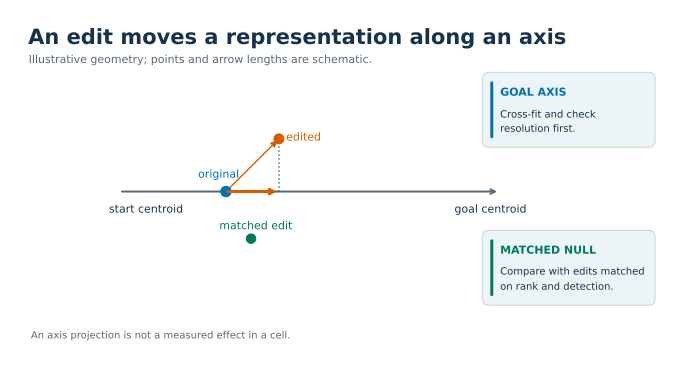
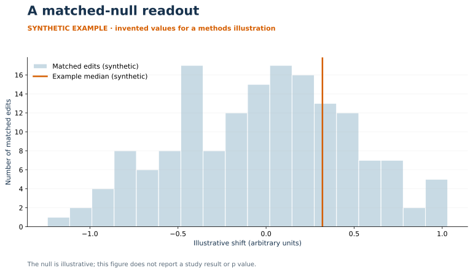

# Statistics

[Figure sources and regeneration](../figures/README.md).

How we test an ISP effect and how we word the outcome. Tags `[D1]` to `[D4]` point to `docs/DATASETS.md`.

## 1. The unit is the donor

Cells from one donor share a patient, a sample, a dissociation and a sequencing run. They are not independent observations of a disease state. A cell-pooled test gives a donor with 1,800 cells nine times the weight of a donor with 200.

- The primary value is one number per donor and gene: the mean per-cell shift over that donor's eligible cells, computed from the raw per-cell output. We do not use the library's cell-pooled summary column for inference.
- The test is across donors. We used an exact two-sided Wilcoxon signed-rank test.
- Report per-donor sign consistency beside the p value.
- With one donor or one library, the unit is the cell within that sample, and the result holds for that sample only.

Equal cells per donor (a fixed-seed draw) make donor weighting and cell weighting the same thing. The cost: donors with too few cells drop out, which selects for cell-rich samples. We record that as a limit and do not correct it.

## 2. Compare with a matched null, never with zero

An edit always moves the embedding, and the size of the move depends on the token's rank, the sequence length and how many cells hold the token. So:

- **Control adjustment.** For each donor, subtract the median shift of the gene's matched controls (same detection and token-rank stratum). A control counts for a donor only if it is estimable in that donor under the same rule as the gene. If fewer than half of the 20 controls qualify, that donor's value is undefined for that gene. The half is a convention fixed in advance; we claim no principled basis for it.
- **Fewer than 20 candidate controls** gives `not_estimable`. Tolerances are not widened after the fact.
- **Raw shifts for the random-gene null.** Random genes are not assigned to control strata afterwards; that would need a matching rule invented post hoc.

## 3. Attainable p values

A discrete exact test cannot go below a floor, and the floor decides what a design can show.

| Test | Floor (two-sided) | Example |
|---|---|---|
| Sign or signed-rank test over d donors | 2 / 2^d | d = 6: 0.031; d = 8: 0.0078; d = 11: 0.00098 |
| Two groups of genes, n per side | 2 / C(2n, n) | 6 per side: 0.0022; 4 per side: 0.029 |
| Empirical p against N matched sets | 1 / (N + 1) | N = 20: 0.048; N = 150: 0.0066 |
| Signed-rank over 3 pairs | 0.25 | Cannot reach 0.05 at all |

Rules that follow:

- Compute the floor after the multiple-testing correction. If the smallest attainable adjusted p is above alpha, the test is not run and the row says `not_estimable`, with n.
- Set donor and gene floors from this table before choosing a dataset. We required at least 6 donors in the analysis set and at least 12 eligible genes for any gene-level statistic.
- Take critical values from the attainable set by enumeration, not from a quantile index into a sorted null, and check a library "exact" test against enumeration when ties are possible.

`patterns/attainable_p.py` computes these floors.

## 4. Families and corrections

- The family and its size m are registered. For a panel, m is the full registered panel per operation, and members that could not be tested enter as p = 1. Choosing m after learning which genes fell out lets the data pick the correction.
- We used Holm within a registered family. Each row reports the raw p, the adjusted p and m.
- Descriptive rows (per unit, per stratum) carry no p value and never join the family later.
- A set-level label rule is itself a test. Simulate its false-positive rate through the exact registered procedure and report it with the label.

## 5. Two operations and the random-gene baseline

We perturb each gene both ways and call a result coherent only if both arms are significant with opposite signs. That is necessary, and by itself it is weak evidence:

- Across random eligible genes, deletion and overexpression shifts toward the goal were negatively rank-correlated: rho -0.593 in lung T cells and -0.245 in colon T cells `[D2, D3]`. Opposite signs are the baseline behaviour of the model.
- A negative correlation means opposite signs. It does not mean "toward the goal". With a control cloud centred on zero, the share of genes that fall in the "toward under one operation, away under the other" quadrant follows from the correlation alone.
- So the reference for "k of n panel genes are coherent" is the same share among random genes, not zero.

Requirements for the comparison to mean anything:

- Both operations are scored on the same cells (I-8 in `docs/ISSUES.md`).
- The random-gene set is drawn by a registered seed from the eligible frame, with a registered size. We ran 100, then a confirmatory extension to 200 from a longer prefix of the same draw, with the rule for reading the pair fixed before either was read.
- The correlation is tested by permutation, with a stability gate (section 6).

## 6. Stability gate

A positive must hold in every leave-one-control-out recomputation and in at least 95% of 10,000 bootstrap draws of the controls, direction included. Otherwise the status is `control_draw_sensitive_open`. A positive whose deletion median changes sign in more than one fold is downgraded to open.

## 7. Calibration and power

- **Calibration.** Report the share of null genes with p below alpha and its exact 95% interval. A rule that fails only on evidence of excess is one-sided; do not call its outcome "calibration passes" without that qualifier. In one screen 4 of 100 null genes had a raw p below 0.05 `[D4]`.
- **Power.** State it before the run, by simulation: the registered null plus a stated alternative, pushed through the exact registered test at the planned n. Report the smallest effect the design can detect.
- **Positive controls.** Include genes known to drive the state. If they fail, negatives cannot be interpreted, and the report words the null with that limit: "the data cannot show that these genes do not act".
- **Direction calls** need both a significance threshold and a minimum effect size, fixed in advance.
- **Empirical p** against N null draws is (1 + number of null values at or above the observed) / (1 + N).
- **Ground truth.** Where a perturbation screen or curated knockouts exist for the same cell type, name them before the run and report precision, recall and the area under the precision-recall curve against baselines (differential-expression rank, expression level, matched random genes). We have not completed such a comparison.

## 8. Reproducibility bands

Measure the noise before reading a threshold.

- **Fine-tune repeat.** Same host, code, seed and data: 95.9% label agreement on held-out cells, per-donor balanced accuracy changing by -0.045 to +0.015, pooled balanced accuracy by 0.0017 `[D2]`. We set a band of 0.045 around the classifier gate. A result inside the band is reported as "pass (or fail), within run-to-run noise of the threshold", and the sign test is recomputed with borderline donors moved each way. The decision still follows the registered rule.
- **Inference repeat and cross-host.** Per-cell shifts: maximum absolute difference at or below 1e-3 and Spearman rho at or above 0.999. In bf16, where cosine values near 1 move in steps of roughly 2^-8, this is in effect a bit-identity test. A different batch shape gives float-level differences in fp32, so a tolerance tied to the effect size suits a re-embedding check better than a fixed 1e-6.
- **Comparator control.** Show that the comparison script detects planted differences: a small offset, a large offset, a reversed order. A reversed order gave a rank correlation near zero in ours `[D2]`.
- **Precision.** Report agreement per operation (section 7 of `docs/APPROACHES.md`).

## 9. Wording

| Situation | Write | Do not write |
|---|---|---|
| Test not possible (too few donors, cells or controls) | "not estimable: 4 donors, floor 6" | "no effect" |
| Tested, not significant | "not separable from the matched null at this n; smallest detectable effect was X" | "no effect", "does not regulate" |
| Significant in the unpredicted direction | "opposite direction" (never a pass) | "significant" |
| Significant, sensitive to the control draw | "open: control-draw sensitive" | "positive" |
| Axis or model failed its check | "unresolved", "void" | Any reading |
| Gate result inside the noise band | "pass, within run-to-run noise of the threshold" | "pass" alone |
| Ambient flag | "resembles known contaminants on a detection axis" | "is contamination" |
| A shift toward a goal direction | "moves along the direction toward" (a sign of a projection) | "reaches", "restores" |

A representation-level shift supports prioritisation and hypotheses about the model. It is not a causal claim about the cell.
